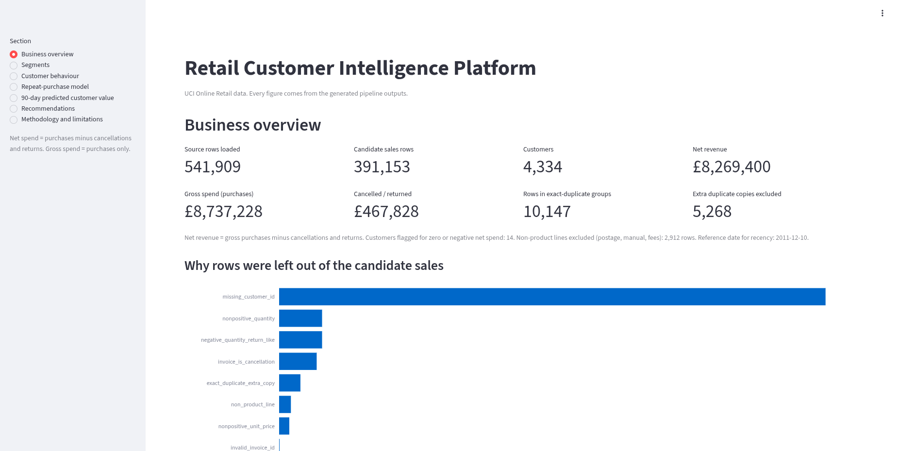
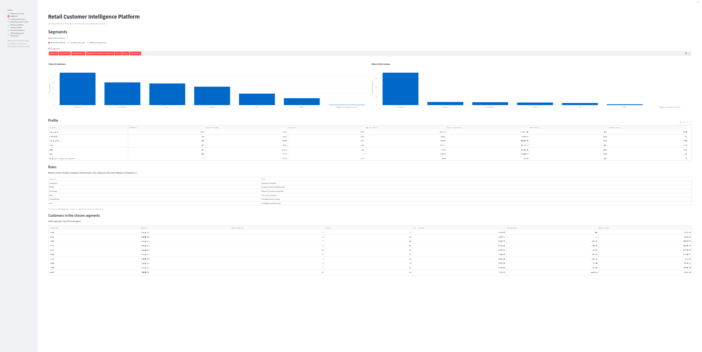
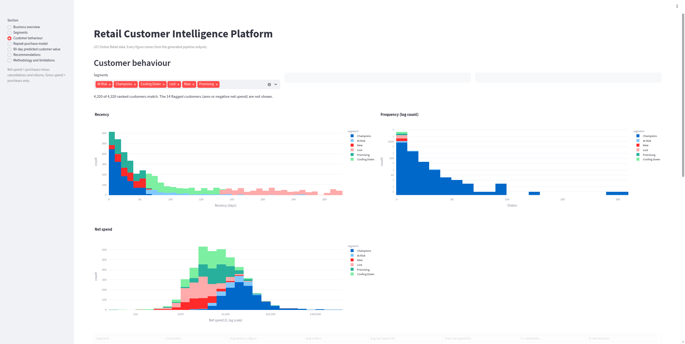
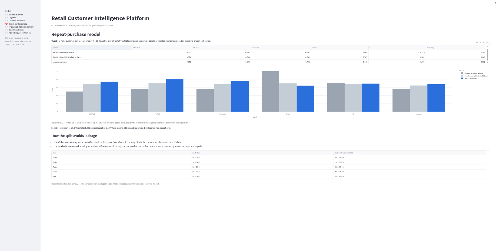
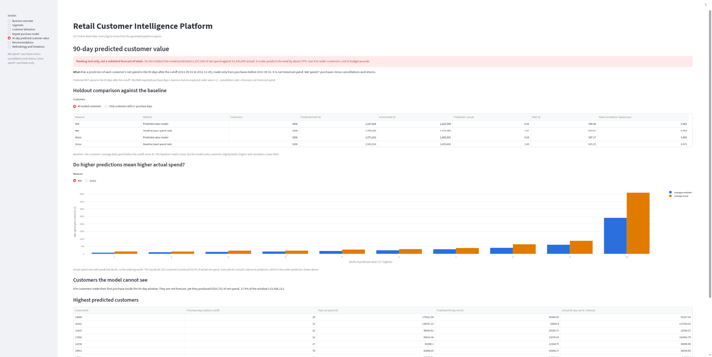
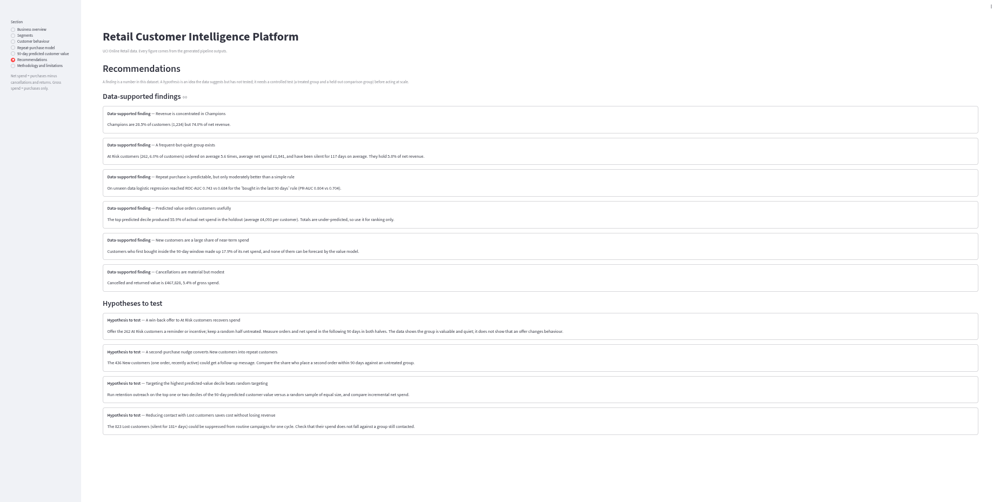
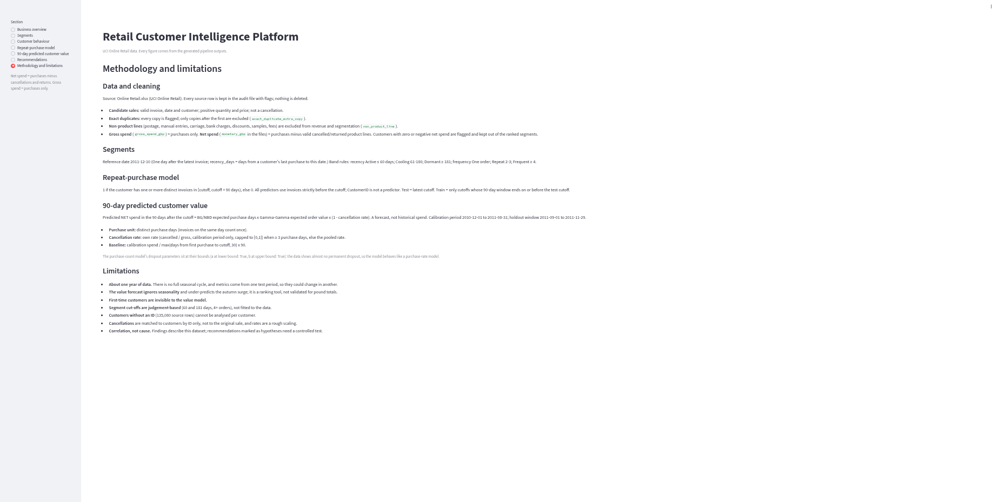

# Retail Customer Intelligence Platform

A portfolio project that turns about a year of UK online-retail transactions (541,909 rows) into an audited customer table, rule-based customer segments, a repeat-purchase model and a 90-day customer value forecast. Every step keeps all source rows, names the reason a row is excluded, and is tested. The results are shown in a local Streamlit dashboard; the project runs on one machine only and is not deployed.

> **Status:** a learning and portfolio project. Results come from a single year of data and one test period, so treat the model numbers as exploratory. The 90-day value forecast under-predicts totals by about 37% and is a ranking tool only (see below).

## Screenshots

| | |
|---|---|
|  |  |
| Business overview | Segments (band rules) |
|  |  |
| Customer behaviour | Repeat-purchase model |
|  |  |
| 90-day predicted customer value | Recommendations |
|  | |
| Methodology and limitations | |

## Dataset

**UCI Machine Learning Repository, "Online Retail"** (transactions of a UK-based, non-store online retailer, 1 December 2010 to 9 December 2011).

- **Page:** <https://archive.ics.uci.edu/dataset/352/online+retail>
- **Direct download (22.6 MB zip):** <https://archive.ics.uci.edu/static/public/352/online+retail.zip>. It contains `Online Retail.xlsx`.
- **License:** Creative Commons Attribution 4.0 International (CC BY 4.0), as stated on the dataset page. It allows sharing and adaptation for any purpose provided appropriate credit is given.
- **Citation (as given on the dataset page):** Chen, D. (2015). *Online Retail* [Dataset]. UCI Machine Learning Repository. <https://doi.org/10.24432/C5BW33>
- **Page lists:** 541,909 instances and 8 columns (InvoiceNo, StockCode, Description, Quantity, InvoiceDate, UnitPrice, CustomerID, Country). An InvoiceNo starting with `c` marks a cancellation.

The data file is **not included in this repository** (`data/raw/` and `data/processed/` are Git-ignored). Download it yourself and place `Online Retail.xlsx` in `data/raw/`.

Note: the dataset page says the data has no missing values, but in the file 135,080 of the 541,909 rows have no CustomerID. This project handles that explicitly (see data-quality findings).

## Pipeline and architecture

```
data/raw/Online Retail.xlsx
        |
        v
[1] Ingest + audit          src/data/pipeline.py
    every row kept, flags added, exclusion reasons named
        |--> transactions_audited.csv  (all 541,909 rows, with flags)
        |--> customer_sales_candidates.csv, net_spend_cancellations.csv, ...
        v
[2] Customer features       src/features/customer_features.py
    recency, orders, gross spend, cancelled spend, NET spend, flags
        v
[3] Segmentation            src/segmentation/rfm.py
    band rules (default), quartile rules, KMeans comparison
        v
[4] Repeat-purchase model   src/models/repeat_purchase.py
    leakage-safe time split, baselines vs logistic regression
        v
[5] 90-day value forecast   src/models/clv.py
    BG/NBD x Gamma-Gamma, scaled by cancellation rate, holdout-tested
        v
[6] Dashboard               app/dashboard.py  (reads only the generated outputs)
```

Generated reports are written to `reports/generated/` (committed, small). Large data files go to `data/processed/` (Git-ignored).

## Data-quality findings

All figures are from `reports/generated/data_quality.json` and `customer_feature_reconciliation.json`.

| Step | Rows |
|---|---|
| Source rows loaded (all kept in the audit file) | 541,909 |
| Customer sales candidates | 391,153 |
| Excluded from candidates (reasons can overlap) | 150,756 |
| Rows with no CustomerID | 135,080 |
| Cancellation invoices (InvoiceNo starts with C) | 9,288 |
| Cancellation or return-like rows (invoice marker or negative quantity) | 10,624 |
| Rows with a non-positive unit price | 2,517 |
| Rows in exact-duplicate groups (every copy flagged) | 10,147 |
| Extra duplicate copies excluded (`exact_duplicate_extra_copy`) | 5,268 |
| Non-product lines excluded (`non_product_line`: postage, manual, fees, ...) | 2,912 |
| Valid cancelled product lines used for net spend | 8,506 |

**What the rules do**

- Only the **first** copy of an exact duplicate stays a candidate; all copies keep their duplicate flag.
- **Non-product lines** (POST, DOT, M, C2, D, S, B, BANK CHARGES, AMAZONFEE, CRUK) are excluded from revenue and segmentation.
- **Gross spend** = purchases only. **Net spend** = purchases minus valid cancelled/returned lines. In the output files net spend is the column `monetary_gbp`; gross spend is `gross_spend_gbp`.

**Effect of the duplicate and non-product rules**

| | Candidate rows | Customers | Revenue (£) |
|---|---|---|---|
| Before the rules | 397,884 | 4,338 | 8,911,407.90 |
| After (gross) | 391,153 | 4,334 | 8,737,227.64 |
| After (net of cancellations) | 391,153 | 4,334 | 8,269,399.91 |
| Sensitivity: duplicates kept, non-products still excluded (gross) | 396,340 | 4,334 | 8,761,066.65 |

The 4 customers who dropped out (15802, 15823, 16742, 17846) had only one candidate row each, and it was a non-product line (manual entries or bank charges).

**Reconciliation (all four checks pass):** 391,153 candidate lines = 391,153 feature lines; 18,402 distinct invoices match; gross £8,737,227.64 matches; 4,334 customers match. Gross £8,737,227.64 minus cancelled £467,827.73 = net £8,269,399.91.

**Cancellations.** Valid-ID customers cancelled £611,342.09 in total. £467,827.73 is subtracted from customers' net spend. The rest is excluded on purpose: £136,938.76 are cancellations of non-product lines, £2,652.62 are extra copies of duplicate rows, and £3,922.98 belong to 28 customers with no candidate purchase. A further 1,719 cancellation rows (£285,470.40) have no customer ID and cannot be assigned to anyone.

**Customers with zero or negative net spend: 14** (for example customer 12346: £77,183.60 bought, £77,183.60 cancelled, net £0.00). They are kept in the data, flagged, and shown as their own group instead of being ranked.

## Segmentation results

Reference date for recency: 2011-12-10 (one day after the last invoice). 4,320 customers are ranked; the 14 flagged customers form a separate group.

### Band rules (the default)

Recency: Active up to 60 days, Cooling 61 to 180, Dormant 181 or more. Frequency: one order, Repeat 2 to 3, Frequent 4 or more.

| Segment | Rule | Customers | Avg recency (days) | Avg orders | Avg net spend (£) | % customers | % net revenue |
|---|---|---|---|---|---|---|---|
| Champions | Frequent and Active | 1,234 | 18.7 | 9.9 | 4,958 | 28.5 | 74.0 |
| Promising | Repeat and Active | 701 | 26.1 | 2.4 | 833 | 16.2 | 7.1 |
| Cooling Down | One/Repeat and Cooling | 864 | 108.0 | 1.7 | 626 | 19.9 | 6.5 |
| At Risk | Frequent and Cooling/Dormant | 262 | 116.6 | 5.6 | 1,841 | 6.0 | 5.8 |
| Lost | One/Repeat and Dormant | 823 | 270.7 | 1.3 | 475 | 19.0 | 4.7 |
| New | One order and Active | 436 | 32.2 | 1.0 | 353 | 10.1 | 1.9 |
| Flagged | zero/negative net spend | 14 | 140.8 | 1.1 | -17 | 0.3 | 0.0 |

### Quartile rules (the first version)

Cut-offs from the data: recency Q25 = 18 days, Q75 = 143 days; frequency Q75 = 5 orders; net spend Q75 = £1,610.46.

| Segment | Customers | Avg recency (days) | Avg orders | Avg net spend (£) | % customers | % net revenue |
|---|---|---|---|---|---|---|
| Champions | 496 | 7.8 | 15.3 | 8,679 | 11.4 | 52.1 |
| Loyal | 574 | 38.7 | 7.6 | 2,914 | 13.2 | 20.2 |
| Developing | 2,693 | 132.4 | 1.8 | 618 | 62.1 | 20.1 |
| Recent | 491 | 9.8 | 2.5 | 855 | 11.3 | 5.1 |
| At Risk | 66 | 221.9 | 4.8 | 3,165 | 1.5 | 2.5 |

This version put 62% of customers into a leftover "Developing" group and only 66 into At Risk, which is why I replaced it as the default.

### KMeans (comparison only)

KMeans on log-scaled, standardised recency, frequency and net spend. The silhouette score falls steadily from k=3 (0.339) to k=8 (0.297), so the data forms a gradient rather than clear clusters; k=3 was chosen as the best score.

| Cluster | Customers | Avg recency (days) | Avg orders | Avg net spend (£) | % customers | % net revenue |
|---|---|---|---|---|---|---|
| Cluster 1 | 742 | 17.3 | 13.6 | 7,502 | 17.1 | 67.3 |
| Cluster 2 | 1,701 | 43.7 | 3.4 | 1,197 | 39.2 | 24.6 |
| Cluster 3 | 1,877 | 167.8 | 1.35 | 355 | 43.3 | 8.1 |

Agreement between methods (adjusted Rand index, 1.0 = identical): quartile vs KMeans 0.37, bands vs KMeans 0.28, quartile vs bands 0.16. The band rules are the most useful for action because they separate situations a marketer cares about (new, slipping, lost); KMeans only cuts the spending gradient into high, middle and low.

## Repeat-purchase model

**Question:** will a customer buy at least once in the 90 days after a cutoff date?

**Leakage-safe split**

- Cutoffs are the first of each month. Features use only purchases strictly *before* the cutoff; the target looks at the next 90 days.
- The test is the latest cutoff. Training uses only cutoffs whose whole 90-day window ends *before* the test starts. A first version trained on cutoffs whose windows overlapped the test period; that is the leak this fixes.

| Role | Cutoff | Outcome window ends |
|---|---|---|
| Train | 2011-03-01 | 2011-05-29 |
| Train | 2011-04-01 | 2011-06-29 |
| Train | 2011-05-01 | 2011-07-29 |
| Train | 2011-06-01 | 2011-08-29 |
| **Test** | **2011-09-01** | **2011-11-29** |

Training rows: 8,960 (53.0% repeat). Test rows: 3,314 customers (56.1% repeat). Tests check that no training window reaches the test period and that changing or removing test-period sales leaves the training data identical.

**Results on the test period**

| Model | ROC-AUC | PR-AUC | Precision | Recall | F1 | Accuracy |
|---|---|---|---|---|---|---|
| Baseline: everyone repeats | 0.500 | 0.561 | 0.561 | 1.000 | 0.719 | 0.561 |
| Baseline: bought in the last 90 days | 0.684 | 0.704 | 0.681 | 0.703 | 0.691 | 0.648 |
| **Logistic regression** | **0.743** | **0.804** | **0.752** | 0.646 | 0.695 | **0.682** |

**F1 caveat:** "everyone repeats" has the highest F1 (0.719) only because 56% of customers repeat, so calling everyone a repeater scores well. Compare ROC-AUC and PR-AUC for ranking quality. Logistic regression ranks better than the simple rule, but the gain is moderate. The threshold is 0.5 and was not tuned on the test.

## 90-day predicted customer value

**What it is:** a *prediction* of each customer's net spend in the 90 days after 2011-09-01, made only from purchases before that date. It is not historical spend, and I do not call it validated customer lifetime value.

**Method:** BG/NBD (expected number of purchase days) x Gamma-Gamma (expected order value) x (1 - the customer's cancellation rate). Purchases are counted by distinct purchase day. The cancellation rate is the customer's own rate (capped to 0-1) if they have 3 or more purchase days, otherwise the pooled rate (4.1%).

**Coverage:** 3,314 customers bought before the cutoff. 8 were excluded because their net spend before the cutoff was zero or negative (recomputed from calibration data only, since the full-year flag uses future data). 3,306 were ranked, of whom 1,424 have a single purchase day and receive the average order value.

**Holdout results (2011-09-01 to 2011-11-29), 3,306 ranked customers**

| | Predicted (£) | Actual (£) | Predicted / actual | MAE (£) | Spearman |
|---|---|---|---|---|---|
| Net, model | 1,527,828 | 2,425,569 | 0.63 | 536.38 | 0.483 |
| Net, baseline (past spend rate) | 2,446,550 | 2,425,569 | 1.01 | 610.92 | 0.463 |
| Gross, model | 1,571,002 | 2,493,830 | 0.63 | 547.17 | 0.492 |
| Gross, baseline | 2,502,910 | 2,493,830 | 1.00 | 625.25 | 0.473 |

Customers with 2 or more purchase days only (1,882): net model 0.61 of actual, MAE £715.97, Spearman 0.577; net baseline 0.88 of actual, MAE £721.17, Spearman 0.537.

**Honest reading**

- The model **under-predicts the total by about 37%** (predicted 63% of actual). Use it to *order* customers, not to forecast pounds.
- It ranks slightly better than the baseline (higher rank correlation, lower MAE), but the baseline's total is much closer.
- Net spend by predicted decile (10 = highest): average predicted and actual rise together, but actual is higher in every decile.

| Decile | 1 | 2 | 3 | 4 | 5 | 6 | 7 | 8 | 9 | 10 |
|---|---|---|---|---|---|---|---|---|---|---|
| Avg predicted (£) | 77 | 108 | 129 | 155 | 190 | 236 | 305 | 402 | 608 | 2,408 |
| Avg actual (£) | 159 | 154 | 213 | 214 | 284 | 316 | 390 | 638 | 873 | 4,093 |

The top decile produced 55.9% of actual net spend.

- A one-off check (not saved in the reports) found 3,222 predicted purchase days against 4,167 actual among the ranked customers, and monthly purchase days rising sharply in September to November. The model assumes a constant purchase rate and cannot anticipate the autumn peak, which I believe is the main cause. I did not tune anything on the holdout to hide this.
- **Customers the model cannot see:** 974 customers first bought inside the window. They produced £529,721.74 of net spend, 17.9% of the window's £2,956,112.66.
- The BG/NBD dropout parameters sit at their bounds: the data shows almost no permanent dropout, so the model behaves like a purchase-rate model. The library's own unbounded fit did not converge on this data, so the likelihood is fitted with bounded parameters and the library's prediction formulas are reused.

## Limitations and what I would do next

**Limitations**

- About one year of data: no full seasonal cycle and a single test period, so metrics could change in another period.
- The value forecast ignores seasonality (under-predicts by about 37%) and cannot forecast first-time customers.
- Segment cut-offs (60 and 181 days, 4 or more orders) are my judgement, not fitted to the data.
- 135,080 source rows have no CustomerID and cannot be analysed per customer.
- Cancellations are matched to customers by ID only, not to the original sale.
- Gamma-Gamma assumes spend is independent of purchase frequency; the correlation here is weak but not zero (Spearman 0.13).
- The dashboard recommendations are findings in this dataset or hypotheses; nothing has been tested with real customers.

**Next steps I would take**

- Add a rolling backtest over several cutoffs to see how stable the metrics are.
- Add a seasonal adjustment to the value forecast, evaluated on a period that was not used to choose it.
- Test the hypotheses in the dashboard (win-back offer for At Risk, second-purchase nudge for New) with a treated and a held-out group.
- Try a model that also uses product and country features for repeat purchase.

## Setup and run (Ubuntu)

Python 3.10 was used. From the project root:

```bash
python3 -m venv .venv
source .venv/bin/activate
python -m pip install --upgrade pip
python -m pip install -r requirements.txt
```

Put `Online Retail.xlsx` in `data/raw/` (see Dataset), then run the pipeline in this order:

```bash
python -m src.data.pipeline                   # audit + candidates + SQLite (about 7.5 minutes)
python -m src.features.customer_features      # customer table with gross and net spend
python -m src.segmentation.rfm                # segments and profiles
python -m src.models.repeat_purchase          # repeat-purchase model and baselines
python -m src.models.clv                      # 90-day predicted customer value
```

Start the dashboard:

```bash
streamlit run app/dashboard.py
```

It opens at <http://localhost:8501> and reads only the generated files. If a file is missing, the page tells you which command to run.

### Tests

```bash
env -u PYTHONPATH .venv/bin/python -m pytest -v
```

`env -u PYTHONPATH` removes the `PYTHONPATH` variable for this one command. On my machine `PYTHONPATH` points at ROS 2 and other workspaces, and those directories can be searched before the virtual environment, so Python could pick up a different version of a package than the one installed in `.venv`. Unsetting it makes the tests use only `.venv`. If your `PYTHONPATH` is empty you can run `python -m pytest -v` directly.

## Project layout

- `src/data/`: ingestion, validation flags, candidate partitioning, reconciliation, SQLite loading
- `src/features/`: customer-level features (recency, frequency, gross, cancelled and net spend)
- `src/segmentation/`: band rules, quartile rules and KMeans
- `src/models/`: repeat-purchase model and the 90-day value forecast
- `app/dashboard.py`: Streamlit dashboard
- `tests/`: unit tests for every rule plus dashboard smoke tests
- `reports/generated/`: small generated reports (committed)
- `docs/screenshots/`: dashboard screenshots
- `data/raw/`, `data/processed/`: local data (Git-ignored)

## What I learned / design decisions

- **Never delete, always name the reason.** Every source row stays in the audit file; excluded rows get a named reason. That made the reconciliation (and the 2-customer and 4-customer questions) answerable with real numbers.
- **A bug can hide in a test that passes.** The first duplicate check compared a unique row-number column, so it found no duplicates. Fixing it and adding tests changed the cohort, so I recorded before/after numbers.
- **Time-based splits need windows, not just dates.** Splitting by cutoff date is not enough if a training row's 90-day outcome overlaps the test period. I now only train on cutoffs whose whole window ends before the test starts, and test that.
- **Always compare against a simple baseline.** Logistic regression beats the "bought recently" rule, but not by a lot, and "everyone repeats" wins on F1.
- **A model can rank well and still be wrong on totals.** The value forecast orders customers sensibly but under-predicts by about 37%. I reported that instead of adjusting it on the holdout.
- **Rule-based segments over KMeans.** The data is a smooth gradient, so KMeans gave generic high/medium/low groups; band rules gave named, actionable groups.
- **Say when a library does not fit.** The standard BG/NBD fit did not converge on this data, so I diagnosed the likelihood, bounded the parameters, and documented it.
- **Dashboards need their own checks.** Reviewing screenshots caught two bugs my tests had not (an empty histogram and a wrong cancellation percentage); both are fixed and now covered by tests.

## License and credits

The dataset is licensed CC BY 4.0 (see Dataset); please cite Chen (2015) if you reuse it. I have not yet chosen a license for the code in this repository.
